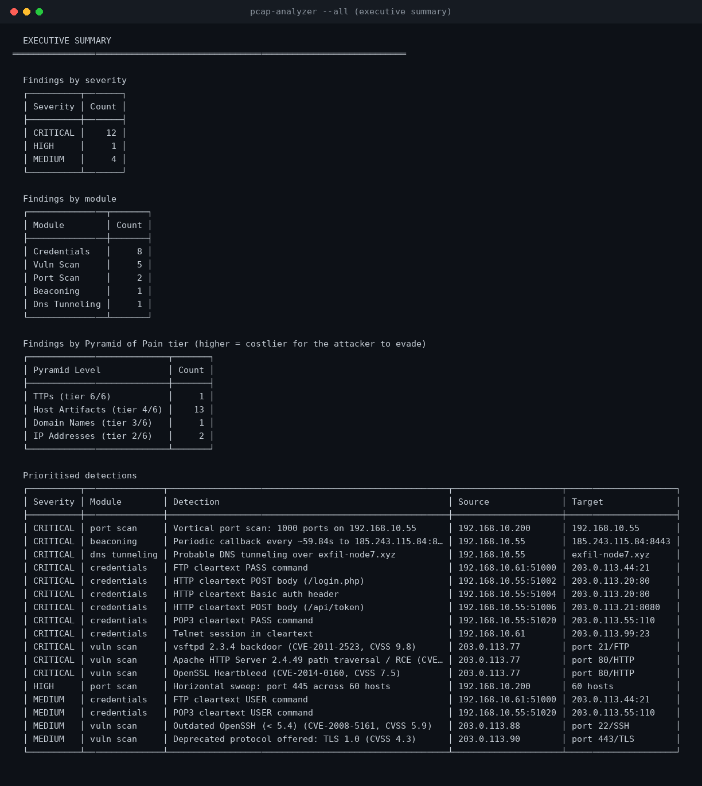

# Network Traffic Analysis Tool with Scapy - PCAP Threat Hunting & Detection

A home-lab threat hunting tool that reads recorded network traffic (PCAP files), flags port scans, C2 beaconing, DNS tunneling, cleartext credentials and known-vulnerable software, and then checks its own conclusions against Wireshark, Nmap and Nessus - the full "capture, detect, validate" loop.

> **Disclaimer:** Built and run entirely inside an isolated Kali Linux VirtualBox lab for educational purposes. The detections run on a synthetic capture generated by this project, and only machines I own were scanned.

---

## Table of Contents

- [Find Things Fast](#find-things-fast)
- [Overview](#overview)
- [Skills Demonstrated](#skills-demonstrated)
- [Lab Architecture](#lab-architecture)
- [Walkthrough](#walkthrough)
- [MITRE ATT&CK Mapping](#mitre-attck-mapping)
- [Key Takeaways](#key-takeaways)
- [Reference](#reference)

---

## Find Things Fast

| I want to... | Go to |
|---|---|
| See what the tool detects, with screenshots | [Walkthrough](#walkthrough) |
| Run it myself | [Run it yourself](#run-it-yourself) |
| See the headline numbers | [Results at a glance](#results-at-a-glance) |
| Understand how one detection works | [Phase index](#phase-index), phases 4 to 8 |
| See the Nmap and Nessus evidence | [evidence/](evidence/README.md) |
| Read the extended build log with term tables | [docs/PROJECT_WALKTHROUGH.md](docs/PROJECT_WALKTHROUGH.md) |
| Look up a command, flag or threshold | [docs/USAGE.md](docs/USAGE.md) |
| Check the tests and performance | [docs/TESTING_AND_PERFORMANCE.md](docs/TESTING_AND_PERFORMANCE.md) |
| Find real captures to try | [docs/TEST_CAPTURES.md](docs/TEST_CAPTURES.md) |
| Know what the tool cannot do | [Limitations](#limitations) |

---

## Overview

In a SOC, an alert often arrives with a packet capture and one question: what happened? This tool automates the first pass. It reads a capture one packet at a time with Scapy, shrinks each packet to a small record, and runs six analyses over the same data. Every finding carries a severity, a MITRE ATT&CK technique ID and a Pyramid of Pain tier, and the vulnerability findings add the CVE, the CVSS score and a fix.

I checked the results three ways: by hand in Wireshark, with 40 automated tests against a capture whose right answers I know, and with active Nmap and Nessus scans of my own lab host.


*One capture goes in. Six modules read the same list of packet records and report through one common Finding structure.*



*The report an analyst reads: findings by severity, by module and by Pyramid of Pain tier, then the prioritised detections.*

### Results at a glance

All results are from the synthetic capture `samples/synthetic_demo.pcap` (2,329 packets).

| Module | Finding | Detail |
|---|---|---|
| Port scan | Vertical scan and sweep | 1,000 ports on 192.168.10.55; port 445 across 60 hosts |
| Beaconing | C2 check-ins | 22 events about 60 s apart, jitter 3.8%, score 100 |
| DNS tunneling | Data in subdomains | exfil-node7.xyz, 140 unique queries, entropy 4.45, score 88 |
| Credentials | Cleartext logins | 8 findings across FTP, HTTP, POP3 and Telnet |
| Vulnerability ID | Known-vulnerable versions | 5 findings, 3 CRITICAL, each with CVE, CVSS and fix |
| Patch tools | Plan and verification | P1 to P4 patch list; 4 resolved and 1 remaining in the demo |
| Active validation | Nmap and Nessus | OpenSSH 10.3p1 with 11 version-matched CVEs; Nessus 92 findings, 1 Medium |

<sub>[Back to top](#table-of-contents)</sub>

---

## Skills Demonstrated

| Area | What it shows |
|---|---|
| Python and Scapy | A single-file command-line tool with streaming packet ingestion, dataclasses, generators, regex and argparse |
| Network protocol analysis | TCP handshake and flags, DNS, HTTP, FTP, Telnet, POP3 and TLS record parsing at packet level |
| Detection engineering | Threshold design, coefficient of variation, median absolute deviation, Shannon entropy, composite scoring and false-positive handling |
| Threat frameworks | MITRE ATT&CK tagging, Pyramid of Pain tiers and IOC export |
| Vulnerability management | CVE and CVSS, passive banner and TLS fingerprinting, Nmap vulnerability scripts, Nessus, triage of scanner output, patch prioritisation and remediation verification tooling |
| Testing | 40 unit tests including negative cases, plus a deliberate-break regression check |
| Tooling | Kali Linux, VirtualBox, Wireshark, Nmap, Nessus Essentials, Git and GitHub |
| Documentation | README walkthrough, build log, flow diagrams and scan evidence |

<sub>[Back to top](#table-of-contents)</sub>

---

## Lab Architecture

Everything runs inside a single Kali Linux VM. The tool never touches a live interface: it only reads capture files.

| Component | Role |
|---|---|
| Kali Linux 2026.2 (VirtualBox) | The analysis machine: runs the tool, Wireshark, Nmap and Nessus |
| Python virtual environment, Scapy 2.7.0 | The analyzer's runtime |
| `tools/generate_test_pcap.py` | Builds a 2,329-packet capture with known attacks inside, so every result can be checked against a known answer |
| Wireshark | Manual baseline for each behaviour |
| Nmap 7.99 | Active scan of the lab host with service detection and vulnerability scripts |
| Nessus Essentials 19.18.5 | Active Basic Network Scan of the lab host |

**How data flows:** `Capture.load()` streams the file with `PcapReader`, one packet at a time. Each packet becomes a `PacketRecord` with nine fields (time, size, protocol, source, destination, ports, TCP flags, payload). Every module reads that shared list and returns `Finding` objects. `main()` tags each finding with its Pyramid of Pain tier and prints the executive summary, with optional JSON, IOC CSV and patch plan outputs.

### Run it yourself

```bash
git clone https://github.com/SujalParmar/pcap-analyzer.git
cd pcap-analyzer
python3 -m venv .venv
source .venv/bin/activate
pip install -r requirements.txt

python3 tools/generate_test_pcap.py -o samples/synthetic_demo.pcap
python3 pcap_analyzer.py -r samples/synthetic_demo.pcap --all
python3 -m unittest discover -s tests
```

Requires Python 3.9 or newer. No root access is needed, because the tool only reads files. All flags and thresholds are in [docs/USAGE.md](docs/USAGE.md).

<sub>[Back to top](#table-of-contents)</sub>

---

## Walkthrough

### Phase index

| Phase | What I did | Result |
|---|---|---|
| [1. Environment setup](#phase-1-environment-setup) | Virtual environment and Scapy in Kali | Scapy 2.7.0 imports cleanly |
| [2. Baseline in Wireshark](#phase-2-baseline-in-wireshark) | Checked each behaviour by hand | 2,329 packets, 440 DNS |
| [3. Reading the capture](#phase-3-reading-the-capture) | Streaming ingestion into small records | 0 malformed packets |
| [4. Port scan detection](#phase-4-port-scan-detection) | Counted distinct ports and targets per source | 1,000-port scan and a 60-host sweep |
| [5. C2 beaconing detection](#phase-5-c2-beaconing-detection) | Scored how regular the check-in gaps are | 22 events, jitter 3.8%, score 100 |
| [6. DNS tunneling detection](#phase-6-dns-tunneling-detection) | Scored entropy, length and uniqueness together | exfil-node7.xyz, score 88 |
| [7. Cleartext credential detection](#phase-7-cleartext-credential-detection) | Regex, base64 and Telnet reassembly | 8 credential findings |
| [8. Passive vulnerability identification](#phase-8-passive-vulnerability-identification) | Matched banners and TLS versions to CVEs | 5 findings, 3 CRITICAL |
| [9. Automated testing](#phase-9-automated-testing) | Tests with known answers, then a deliberate break | 40 pass; a broken fix is caught |
| [10. Active scan with Nmap](#phase-10-active-scan-with-nmap) | Cross-checked with an active scan | OpenSSH 10.3p1, 11 version-matched CVEs |
| [11. Active scan with Nessus](#phase-11-active-scan-with-nessus) | Basic Network Scan of the lab host | 92 findings, 1 Medium (self-signed certificate) |
| [12. Patch plan and remediation check](#phase-12-patch-plan-and-remediation-check) | Prioritised patches and a before/after check | 4 resolved, 1 remaining in the demo |

### Phase 1: Environment setup

I created a Python virtual environment inside the Kali VM and installed the one dependency, Scapy, pinned to `2.7.0` so the behaviour is reproducible.


<sub>[Back to top](#table-of-contents) | [Phase index](#phase-index)</sub>

### Phase 2: Baseline in Wireshark

Before automating anything I opened the capture in Wireshark and confirmed each behaviour by hand with display filters: the SYN flood from the scanner, the random-looking DNS names, the plain-text FTP login and the HTTP form post. The capture holds 2,329 packets, and the `dns` filter displayed 440 of them, a number the tool later reproduced exactly.


<sub>[Back to top](#table-of-contents) | [Phase index](#phase-index)</sub>

### Phase 3: Reading the capture

A capture is raw binary, so the tool first turns each packet into a small `PacketRecord`. `Capture.load()` streams the file packet by packet instead of loading it whole, and a `try/except` counts malformed packets instead of crashing.

```bash
python3 pcap_analyzer.py -r samples/synthetic_demo.pcap --summary
```


**Result:** 2,329 packets parsed, 0 malformed, 440 DNS packets (matching Wireshark). The top talker by bytes is the busy normal host, 192.168.10.61. The scanner, 192.168.10.200, sends the most packets but few bytes, and talks to 60 peers. Volume alone does not find an attacker, so the later modules count distinct ports, targets, timing and randomness instead.

<sub>[Back to top](#table-of-contents) | [Phase index](#phase-index)</sub>

### Phase 4: Port scan detection


The module keeps TCP packets with SYN set and ACK clear (new connection attempts) and uses Python sets to count distinct ports per target (vertical scan) and distinct targets per port (horizontal sweep). Fifteen or more raises a finding. Replies are cross-checked: SYN-ACK means open, RST means closed.

```bash
python3 pcap_analyzer.py -r samples/synthetic_demo.pcap --scan
```


**Result:** `192.168.10.200` scanned 1,000 ports on `192.168.10.55` at 76.9 ports per second (CRITICAL), and ports 22, 80, 135, 139 and 445 answered as open. It then swept port 445 across 60 hosts (HIGH).

<sub>[Back to top](#table-of-contents) | [Phase index](#phase-index)</sub>

### Phase 5: C2 beaconing detection


Malware that checks in with its controller on a timer produces very regular gaps. Packets are grouped into flows, bursts are collapsed into one event per check-in, and the gaps between events are scored with the coefficient of variation, a median-absolute-deviation ratio and payload-size uniformity. A score above 65 with at least 6 events is flagged.

```bash
python3 pcap_analyzer.py -r samples/synthetic_demo.pcap --beacon
```


**Result:** `192.168.10.55` to `185.243.115.84:8443` showed 22 events, an average interval of 59.84 s, jitter of 3.8% and a score of 100 (CRITICAL). A beacon with deliberate heavy jitter would score lower, which is a documented limit.

<sub>[Back to top](#table-of-contents) | [Phase index](#phase-index)</sub>

### Phase 6: DNS tunneling detection


Data hidden in DNS shows up as long, random, always-new subdomains. Each name is split into subdomain and registered domain, then scored on Shannon entropy, label length, the share of unique subdomains, volume and record type. Entropy alone would flag random-looking CDN names, so the signals are combined.


*Entropy in bits per character: a repeated letter scores 0, real words about 2, and an encoded chunk 4.22.*

```bash
python3 pcap_analyzer.py -r samples/synthetic_demo.pcap --dns
```


**Result:** `exfil-node7.xyz` had 140 queries and 140 unique subdomains, an average entropy of 4.45 and a score of 88 (CRITICAL), with an estimated 3.3 KB sent out. The 300 ordinary lookups were not flagged.

<sub>[Back to top](#table-of-contents) | [Phase index](#phase-index)</sub>

### Phase 7: Cleartext credential detection


Each protocol leaks credentials differently, so each gets its own check: regex for HTTP forms and JSON, base64 decoding for Basic auth, line matching for FTP and POP3, and session reassembly for Telnet. Secrets are masked by default.

```bash
python3 pcap_analyzer.py -r samples/synthetic_demo.pcap --creds
```


**Result:** 8 findings across FTP, HTTP, POP3 and Telnet (6 CRITICAL, 2 MEDIUM). With `--show-secrets` the values are revealed; they come from the synthetic capture, not real accounts.

**A bug I found here:** my first Telnet version grouped packets by `(src, dst)`, which separated the server's prompts from the client's typed answers, so the report showed `Password:` with no password. Both directions are now grouped by the sorted address pair and ordered by time.


<sub>[Back to top](#table-of-contents) | [Phase index](#phase-index)</sub>

### Phase 8: Passive vulnerability identification


This module sends nothing. It reads the version banners services announce in the capture and the TLS version in a ClientHello, and matches them against a table of known-vulnerable releases. Each entry carries the CVE, the published CVSS score and a one-line fix.


```bash
python3 pcap_analyzer.py -r samples/synthetic_demo.pcap --vuln
```


**Result:** 5 findings, 3 CRITICAL: vsftpd 2.3.4 (CVE-2011-2523, 9.8), Apache 2.4.49 (CVE-2021-41773, 9.8), Heartbleed found in the Apache `Server:` header (CVE-2014-0160, 7.5), outdated OpenSSH (CVE-2008-5161, 5.9) and TLS 1.0 offered (4.3).

**A bug I found here:** the vsftpd signature was case-sensitive, but the real banner reads `vsFTPd`, so the match failed silently. Every signature now uses `re.IGNORECASE`, and a test guards it.

<sub>[Back to top](#table-of-contents) | [Phase index](#phase-index)</sub>

### Phase 9: Automated testing

```bash
python3 -m unittest discover -s tests -v
```


The suite checks each module against the known contents of the synthetic capture, including negative cases: an innocent host is not flagged as a scanner and `google.com` is not flagged as a tunnel. To prove the tests catch real regressions, I removed the case-insensitivity fix from a copy of the file on purpose.


*Removing the fix gave `FAILED (failures=2, errors=1)`, all in the vulnerability tests. Restoring the file brought the suite back to green.*

More detail is in [docs/TESTING_AND_PERFORMANCE.md](docs/TESTING_AND_PERFORMANCE.md).

<sub>[Back to top](#table-of-contents) | [Phase index](#phase-index)</sub>

### Phase 10: Active scan with Nmap

The analyzer is passive, so I cross-checked it with an active scan of my own Kali host (with SSH started so there was a service to find), using `nmap -sV --script vuln` through `tools/run_nmap_scan.sh`.

```bash
chmod +x tools/run_nmap_scan.sh
sudo systemctl start ssh
./tools/run_nmap_scan.sh 127.0.0.1
sudo systemctl stop ssh
```


**Result:** Nmap 7.99 finished in 16.21 seconds. Port 22 was open running OpenSSH 10.3p1 Debian 4, and the `vulners` script listed 11 CVEs matched to that version, with scores from 2.5 to 9.4.

**Triage.** The top entry, CVE-2026-60002, is a use-after-free in the OpenSSH client (`ssh`) during key re-exchange, fixed in OpenSSH 10.4p1 ([release notes](https://www.openssh.org/releasenotes.html#10.4p1)). It occurs only on the client side, so it concerns the `ssh` binary rather than the `sshd` service Nmap probed. Published scores differ between sources, and the CISA entry in the CVE record lists exploitation as "none" and automatable as "no". For a lab host that is low urgency. The other entries are version matches of the same kind and were not researched one by one.

**Why Nmap and the analyzer disagree.** The analyzer matches banners against a small curated table with no entry for OpenSSH 10.x, so it reports nothing for this host. The `vulners` script looks the version up in a large database, so it reports more. A version match shows possible exposure only: distributions can backport fixes without changing the version string.

<sub>[Back to top](#table-of-contents) | [Phase index](#phase-index)</sub>

### Phase 11: Active scan with Nessus

A Basic Network Scan with Nessus Essentials against the Kali host (`192.168.10.250`) took 9 minutes and reported 92 findings, nearly all Info, plus one Medium.


The Medium finding was **SSL Certificate Cannot Be Trusted** (plugin 51192, CVSS v3.0 6.5) on port 8834.


Port 8834 is Nessus's own web interface, and the certificate is the self-signed one Nessus generates when it is installed. So the finding concerns the scanner's own management page, not the operating system, and the fix is a trusted certificate rather than a software patch. Nessus Essentials cannot export reports, so the evidence is these screenshots plus the written summary in [evidence/nessus/nessus_scan_summary.md](evidence/nessus/nessus_scan_summary.md).

<sub>[Back to top](#table-of-contents) | [Phase index](#phase-index)</sub>

### Phase 12: Patch plan and remediation check

Finding a vulnerable version is the first step. Patch management also needs an order to work in and a way to confirm a fix worked, so the tool has two features for those steps.

`--patch-plan` turns the vulnerability findings into a list ordered by CVSS score, with a priority band, an example patch window and the fix. The bands are P1 at 9.0 and above (within 72 hours), P2 at 7.0 to 8.9 (7 days), P3 at 4.0 to 6.9 (30 days) and P4 below 4.0 (next maintenance cycle). The windows are examples. Set them to your own policy.


`--compare` checks a fix by comparing two `--json` reports and listing what is resolved, still present or new. To test it, the capture generator has a `--patched` option that builds the same traffic with vsftpd, OpenSSH, OpenSSL and the TLS version upgraded, and leaves Apache 2.4.49 unpatched on purpose so the check has something to catch.

```bash
python3 tools/generate_test_pcap.py -o samples/before.pcap
python3 tools/generate_test_pcap.py -o samples/after.pcap --patched
python3 pcap_analyzer.py -r samples/before.pcap --vuln --json reports/before.json
python3 pcap_analyzer.py -r samples/after.pcap --vuln --json reports/after.json
python3 pcap_analyzer.py --compare reports/before.json reports/after.json
```


**Result:** 4 findings resolved, 1 still present (Apache 2.4.49), 0 new, so 80% of the earlier findings were gone. The command exits with 1 while anything remains.

These features cover the planning and verification steps. Applying the patches happens on the systems being managed, outside this tool, and the before and after captures here are synthetic. Findings are matched by module, source, target and title, so the check works best on the vulnerability findings, whose titles stay the same between runs.

<sub>[Back to top](#table-of-contents) | [Phase index](#phase-index)</sub>

---

## MITRE ATT&CK Mapping

These are the technique IDs the tool attaches to its findings.

| ID | Technique | Module | Observed in this project |
|---|---|---|---|
| T1046 | Network Service Discovery | Port scan | 1,000-port scan and a port 445 sweep |
| T1071 | Application Layer Protocol | Beaconing | 22 check-ins about every 60 s |
| T1573 | Encrypted Channel | Beaconing | Tagged alongside T1071 for beacons that use encrypted channels |
| T1071.004 | Application Layer Protocol: DNS | DNS tunneling | 140 unique high-entropy subdomains |
| T1048.003 | Exfiltration Over Alternative Protocol (unencrypted non-C2) | DNS tunneling | About 3.3 KB estimated sent out through DNS |
| T1040 | Network Sniffing | Credentials | Cleartext credentials readable from the recording |
| T1552.001 | Unsecured Credentials: Credentials in Files | Credentials | Tagged alongside T1040 |
| T1592.002 | Gather Victim Host Information: Software | Vulnerability ID | Software versions read from banners |

Each finding is also placed on the Pyramid of Pain, which ranks indicators by how costly they are for an attacker to change:

| Module | Pyramid tier | Why |
|---|---|---|
| Port scan | IP addresses (2 of 6) | Blocking the source IP costs the attacker nothing to rotate |
| DNS tunneling | Domain names (3 of 6) | Blocking the domain works until they register a new one |
| Credentials, vulnerability ID | Host artifacts (4 of 6) | Tied to a specific host's configuration or software |
| Beaconing | TTPs (6 of 6) | It is the attacker's behaviour, and changing it means rebuilding their tooling |

<sub>[Back to top](#table-of-contents)</sub>

---

## Key Takeaways

- **Volume is not the signal.** The scanner sent few bytes but touched 1,000 ports and 60 hosts. Counting distinct ports, peers, timing and randomness found what byte counts hid.
- **One signal is rarely enough.** Entropy alone would flag CDN names, so DNS tunneling is scored on randomness, length, uniqueness, volume and record type together.
- **Protocols have shape.** The Telnet password only appeared once both directions of the conversation were rebuilt in time order.
- **Silent failures are the worst bugs.** The vsftpd signature missed its banner without any error. A test that can fail, and a deliberate break to prove it, is what caught it.
- **A version match is not proof.** Nmap listed 11 CVEs for OpenSSH 10.3p1 while the analyzer listed none. Triage showed the top one was client-side and fixed in a newer release, and distributions can backport fixes.
- **Passive and active scanning answer different questions.** A recording shows what spoke; a scan shows what is exposed now. Using both is what made the findings trustworthy.
- **Know where your tools end.** Every limit below is documented on purpose.

<sub>[Back to top](#table-of-contents)</sub>

---

## Reference

### Documentation

| Page | What is in it |
|---|---|
| [docs/README.md](docs/README.md) | Index of all documentation |
| [docs/PROJECT_WALKTHROUGH.md](docs/PROJECT_WALKTHROUGH.md) | Extended build log with term tables for every phase |
| [docs/USAGE.md](docs/USAGE.md) | Commands, tuning flags, IOC CSV format, exit codes |
| [docs/TESTING_AND_PERFORMANCE.md](docs/TESTING_AND_PERFORMANCE.md) | The 40 tests and measured performance |
| [docs/TEST_CAPTURES.md](docs/TEST_CAPTURES.md) | Where to get real captures, and how to handle malware safely |
| [evidence/README.md](evidence/README.md) | Index of the Nmap and Nessus evidence |

### Limitations

What the tool does not do:

- It was validated on a synthetic capture with known answers. Accuracy on real attack traffic has not been measured, and the thresholds are sensible defaults, not values tuned on real data.
- No TCP stream reassembly. Credentials split across segment boundaries are missed.
- Encrypted traffic is only analysed by timing and volume. TLS-wrapped C2 is caught by the beaconing module but its content is not inspected; JA3/JA4 fingerprinting would be the natural next addition.
- The registered-domain split is a heuristic list, not the full Public Suffix List, so unusual multi-part TLDs may be split incorrectly.
- Detections are threshold-based, not behavioural baselines. A scan slower than the window, or a beacon with deliberately high jitter, will evade it.
- IPv6 endpoints are counted and summarised, but the transport-layer detections are tuned against IPv4 traffic.
- The vulnerability signature table is a small, hand-curated set (about 10 CVEs) chosen for low false-positive risk. It only sees what is in the capture, so a vulnerable service that never sent a banner will not be caught, and a banner match can be a backported, already-fixed version. It complements an active scanner (Nessus, OpenVAS) and does not replace one.
- The patch plan and remediation check cover planning and verification. They do not apply patches.
- Nessus Essentials cannot export reports, and the license in my install was time-limited, so the Nessus evidence is screenshots and a written summary.

### Project structure

```
pcap-analyzer/
├── pcap_analyzer.py            # Main tool (6 detection modules, patch plan, CLI)
├── requirements.txt
├── README.md
├── LICENSE
├── tools/
│   ├── generate_test_pcap.py   # Synthetic capture generator (--patched variant)
│   ├── render_screenshot.py    # Renders terminal output to PNG for docs
│   └── run_nmap_scan.sh        # Active-scan companion (Nmap)
├── tests/
│   ├── test_detections.py      # 30 unit tests
│   └── test_patch_tools.py     # 10 tests for the patch plan and remediation check
├── docs/                       # Index, extended build log, usage, testing, captures
│   ├── diagrams/               # Architecture and per-module logic diagrams
│   └── screenshots/            # Screenshots taken during each phase
├── evidence/                   # Nmap and Nessus scan evidence (with an index)
├── images/                     # Rendered output images
├── samples/                    # Captures (gitignored)
└── reports/                    # JSON/CSV output (gitignored)
```

### Author

**Sujal Chetan Parmar**

### License

MIT - see [LICENSE](LICENSE).

<sub>[Back to top](#table-of-contents)</sub>
