# PCAP Analyzer: build, test and validation log

This is the record of how I set up the project, how each detection module works,
what I saw when it ran, and how I checked it against independent tools. It
follows the order I did the work in.

**Environment:** Kali Linux 2026.2 in VirtualBox, a Python virtual environment, Scapy 2.7.0.

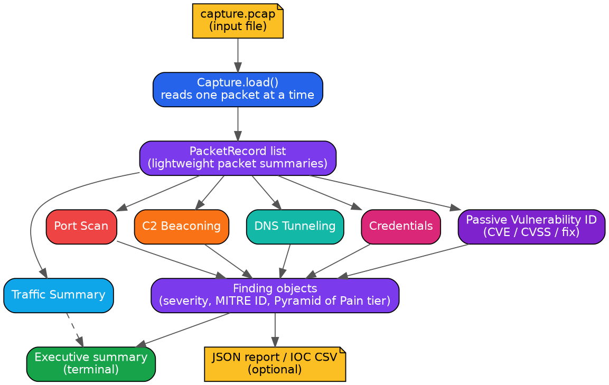

*One capture file goes in. Six modules read the same list of simplified packet
records, and every module reports through one common `Finding` structure.*

| Phase | Topic |
|---|---|
| 1 | Environment setup |
| 2 | Networking basics and manual inspection in Wireshark |
| 3 | Reading the capture |
| 4 | Port scan detection |
| 5 | C2 beaconing detection |
| 6 | DNS tunneling detection |
| 7 | Cleartext credential detection |
| 8 | Passive vulnerability identification |
| 9 | Automated testing |
| 10 | Active scan with Nmap |
| 11 | Active scan with Nessus |
| 12 | Patch planning and remediation check |
| 13 | Publishing |

All results below come from `samples/synthetic_demo.pcap`, which
`tools/generate_test_pcap.py` builds. The capture is made so the right answers
are known in advance: one port scan, one beacon, one DNS tunnel, several leaked
credentials and several vulnerable service banners.

---

## Phase 1: Environment setup

```bash
unzip pcap-analyzer.zip && cd pcap-analyzer
python3 -m venv .venv
source .venv/bin/activate
pip install -r requirements.txt
python3 -c "import scapy; print(scapy.__version__)"
```

| Term | Meaning |
|---|---|
| Virtual environment (venv) | An isolated set of Python packages for this project, so installs here cannot affect the rest of the system |
| pip | Python's package installer |
| `requirements.txt` | The packages to install. It has one line: `scapy==2.7.0` |
| Scapy | The library that reads and decodes packet captures |

Scapy 2.7.0 installed and imported inside the virtual environment.

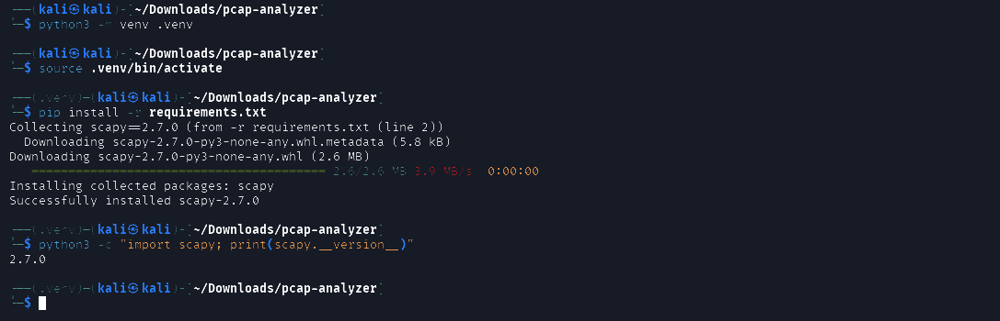

---

## Phase 2: Networking basics and manual inspection

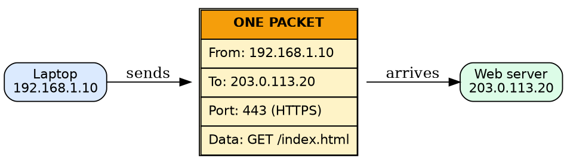
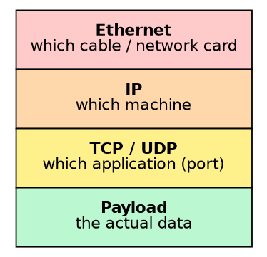

| Term | Meaning |
|---|---|
| Packet | One small unit of data sent over a network |
| PCAP file | A recording of many packets with timestamps |
| IP address | Identifies a machine |
| Port | Identifies an application on a machine (80 web, 21 FTP, 23 Telnet, 443 HTTPS) |
| TCP / UDP | Connection-based and connectionless transport protocols |
| SYN / ACK / RST | TCP flags: start a connection, acknowledge, refuse |
| DNS | Translates names into IP addresses |
| Payload | The data carried inside a packet |

Before automating anything I confirmed each behavior by hand in Wireshark:

```bash
python3 tools/generate_test_pcap.py -o samples/synthetic_demo.pcap
wireshark samples/synthetic_demo.pcap &
```

| Display filter | What it shows |
|---|---|
| `tcp.flags.syn==1 && tcp.flags.ack==0` | The flood of connection attempts from the scanner |
| `dns` | Normal lookups plus the random-looking tunnel queries |
| `ftp` | A username and password in plain text |
| `http` | A login form submission with credentials visible |

The capture holds **2,329 packets**. The `dns` filter displayed **440** of them
(18.9%), a number that later matched the tool's own count.

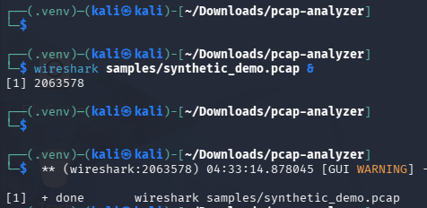

---

## Phase 3: Reading the capture

A capture is raw binary, so the tool first turns it into something easy to work
with. `Capture.load()` streams the file with Scapy's `PcapReader`, one packet at
a time, and converts each packet into a small `PacketRecord` that keeps nine
fields: timestamp, size, protocol, source, destination, source port,
destination port, TCP flags and payload. Every detection module then reads the
same list of records.

A `try/except` around each packet counts malformed packets and skips them, so
one corrupted packet cannot stop an analysis.

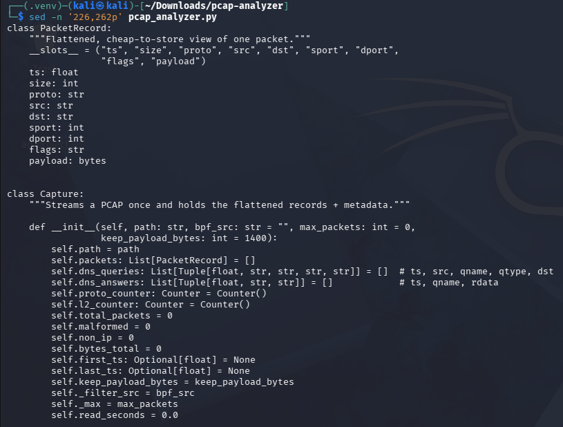

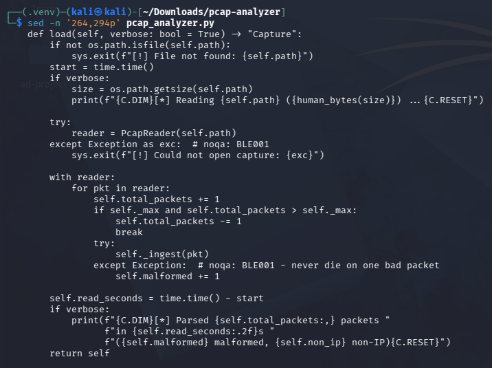

```bash
python3 pcap_analyzer.py -r samples/synthetic_demo.pcap --summary
```

The tool reported `Parsed 2,329 packets` with 0 malformed, and a DNS count of
440, which matches Wireshark.

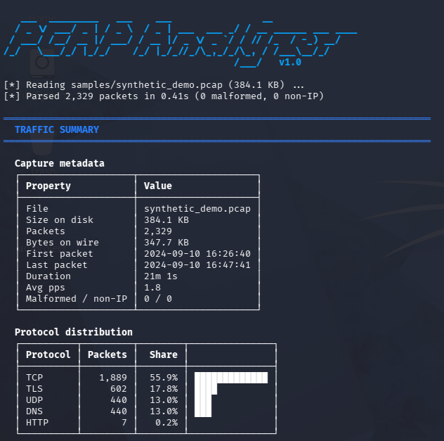

The top talker by bytes sent was `192.168.10.61` (247.3 KB, a normal busy host).
The scanner `192.168.10.200` sent the most packets (1,060) but few bytes, and
it had **60 peers**, which is the signal the next phase uses.

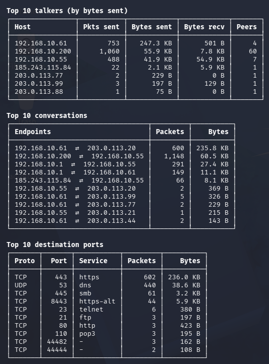

---

## Phase 4: Port scan detection

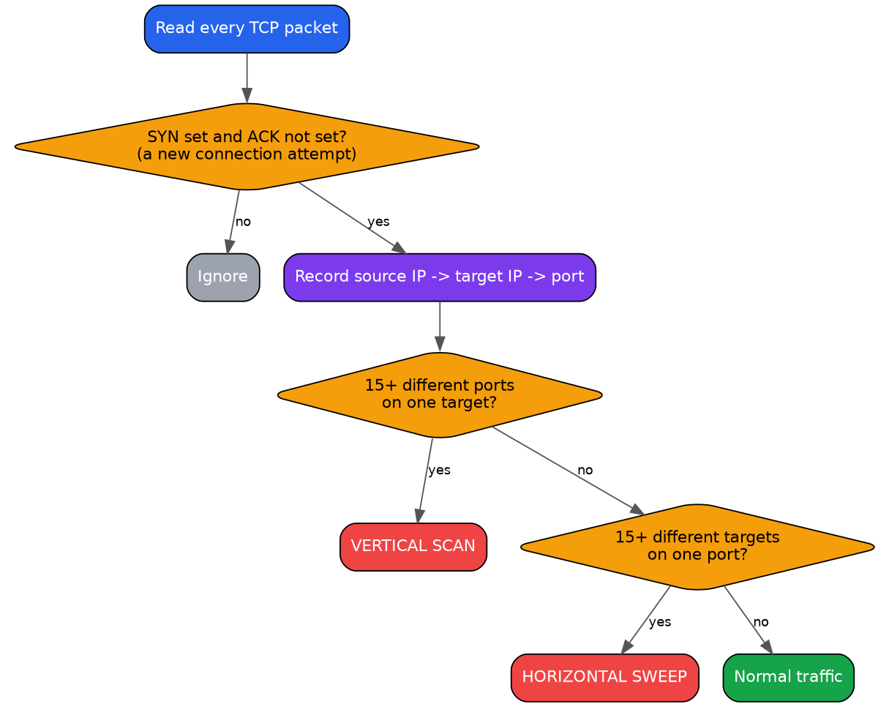

The module keeps TCP packets with SYN set and ACK clear (new connection
attempts). It builds two maps using Python sets, which ignore duplicates, so a
set's length is the number of distinct items:

- source, then target, then set of ports: a **vertical scan**
- source and port, then set of targets: a **horizontal sweep**

Fifteen or more distinct ports or targets raises a finding. Replies are
cross-checked: SYN/ACK means open, RST means closed.

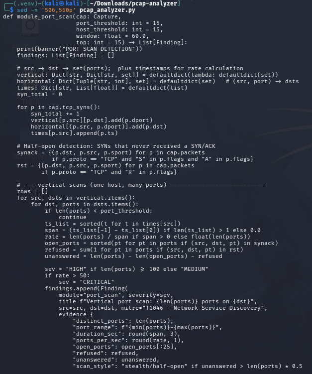

```bash
python3 pcap_analyzer.py -r samples/synthetic_demo.pcap --scan
```

`192.168.10.200` scanned **1,000 ports** on `192.168.10.55`, and ports **22, 80,
135, 139 and 445** answered as open. The same source then swept **port 445
across 60 hosts**. MITRE ATT&CK: T1046.

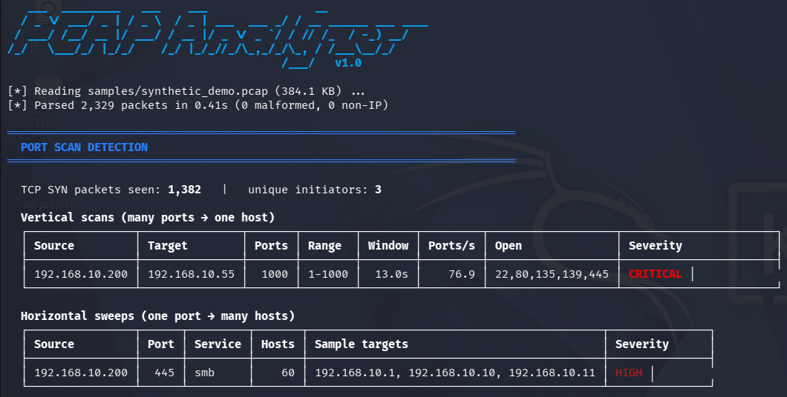

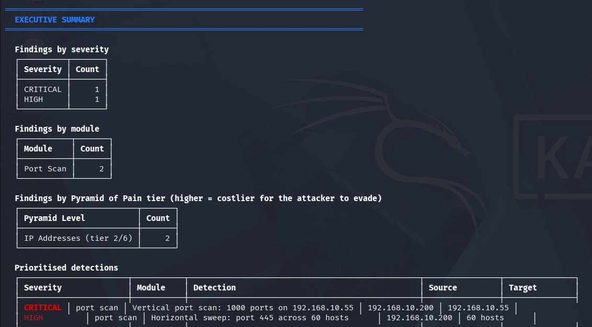

---

## Phase 5: C2 beaconing detection

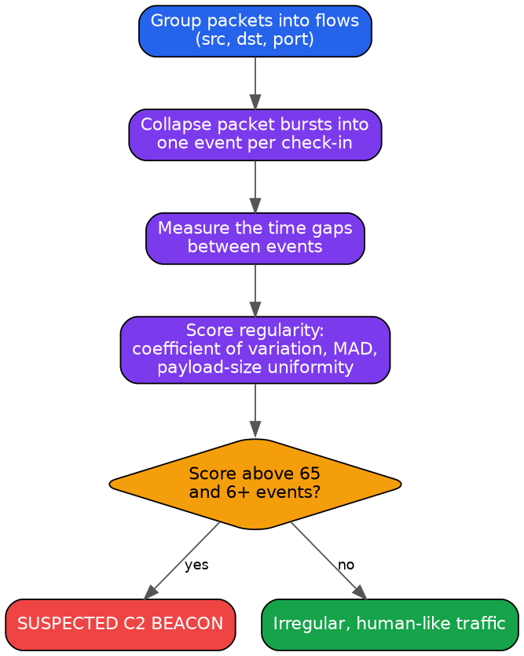

Malware that checks in with its controller on a timer produces very regular
gaps. Packets are grouped by flow, bursts are collapsed into one event per
check-in, and the gaps between events are scored with the coefficient of
variation, a median-absolute-deviation ratio and payload-size uniformity. A
score above 65 with at least 6 events is flagged.

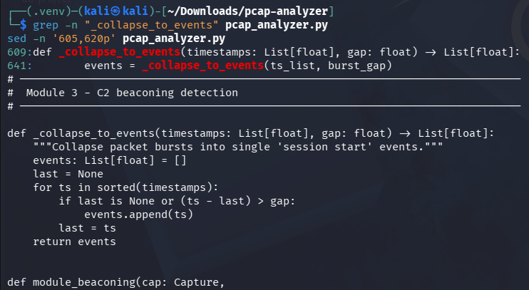

```bash
python3 pcap_analyzer.py -r samples/synthetic_demo.pcap --beacon
```

`192.168.10.55` to `185.243.115.84:8443` showed **22 events**, an average
interval of **59.84 s**, jitter of **3.8%** and a score of **100** (CRITICAL).

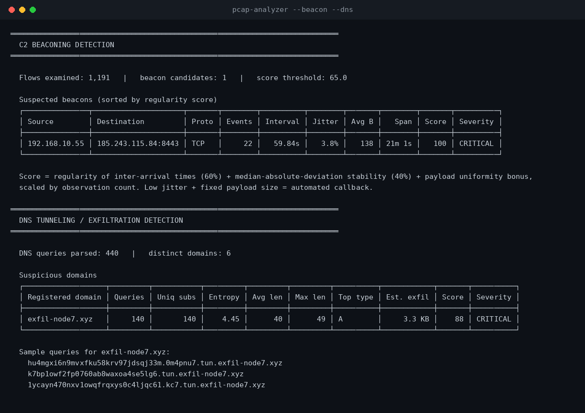

A beacon with deliberately high jitter would score lower and could evade a
purely timing-based check. That limit is also listed in the README.

---

## Phase 6: DNS tunneling detection

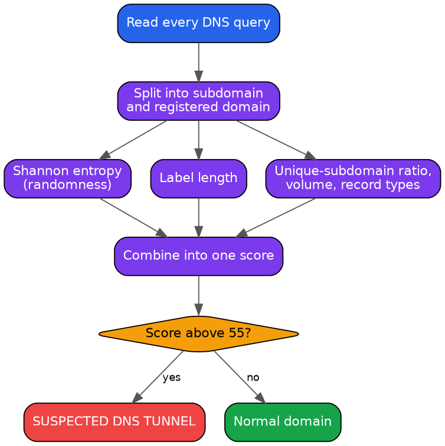

Data hidden in DNS shows up as long, random, always-new subdomains. Each query
is split into a subdomain and a registered domain, then scored on Shannon
entropy (bits per character), label length, the share of unique subdomains,
volume and record types. Entropy alone would flag random-looking CDN names, so
the signals are combined into one score.

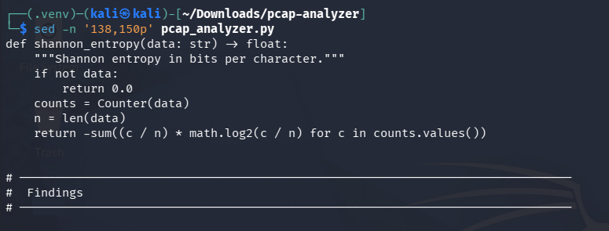

| Text | Entropy (bits per character) |
|---|---|
| `www` | 0.0 (Python prints it as `-0.0`, a negative zero) |
| `google` | 1.92 |
| `github` | 2.58 |
| `k7bp1owf2fp0760ab8waxoa4se5lg6` | 4.22 |

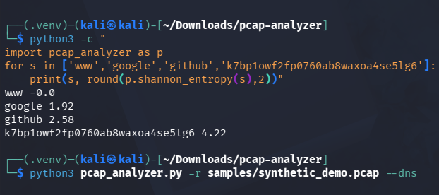

```bash
python3 pcap_analyzer.py -r samples/synthetic_demo.pcap --dns
```

`exfil-node7.xyz` had **140 queries and 140 unique subdomains**, an average
entropy of **4.45** and a score of **88** (CRITICAL). The 300 ordinary lookups
(google.com, github.com and so on) were not flagged. MITRE ATT&CK: T1071.004.

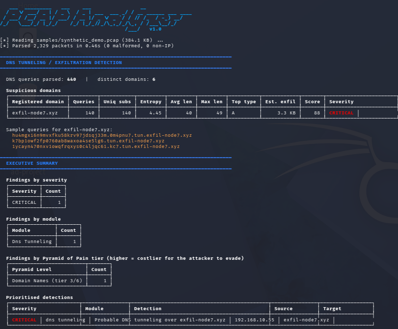

---

## Phase 7: Cleartext credential detection

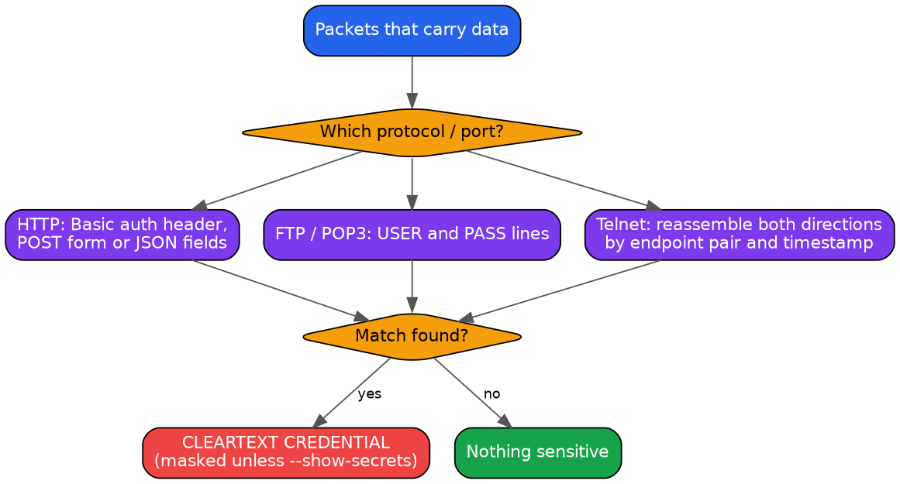

Each protocol exposes credentials differently, so each gets its own check:

| Protocol | Where the credential sits | Method |
|---|---|---|
| HTTP form or JSON | `password=...` in the request body | Regular expressions |
| HTTP Basic auth | `Authorization: Basic ...` | Regex, then base64 decode |
| FTP and POP3 | `USER` and `PASS` lines | Line matching |
| Telnet | Typed character by character across packets | Session reassembly |

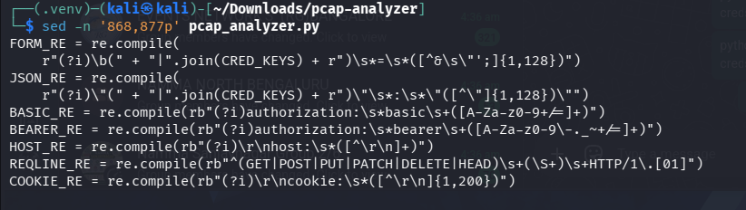

Secrets are masked by default and shown only with `--show-secrets`.

```bash
python3 pcap_analyzer.py -r samples/synthetic_demo.pcap --creds
python3 pcap_analyzer.py -r samples/synthetic_demo.pcap --creds --show-secrets
```

The tool found **8 credential findings** (FTP, three HTTP, POP3 and a Telnet
session). `USER` lines are rated MEDIUM and `PASS` lines CRITICAL.

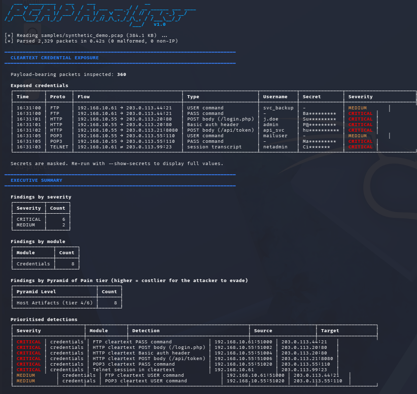

The values in the revealed run come from the synthetic capture and are not real
credentials.

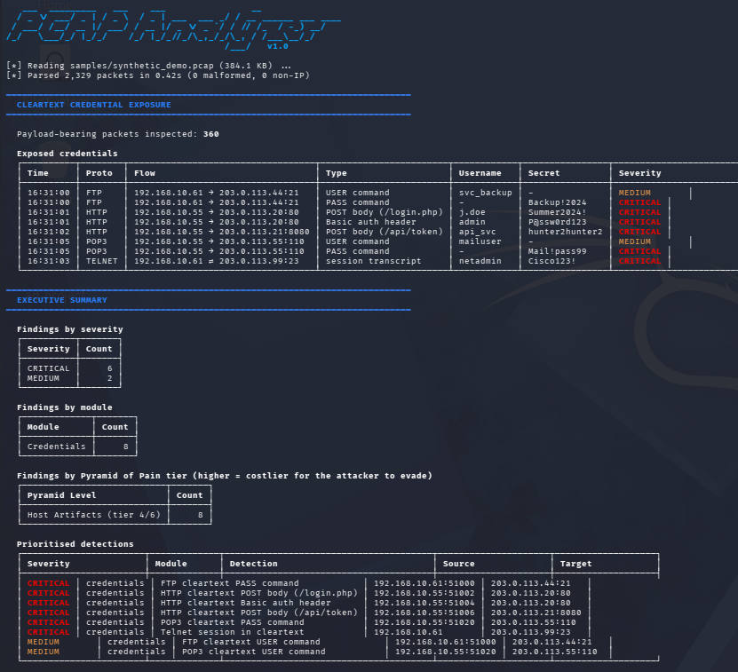

**A bug I found here:** the first Telnet version grouped packets by
`(src, dst)`, which separated the server's prompts from the client's typed
answers, so the report showed `Password:` with no password. Both directions are
now grouped by the sorted endpoint pair and ordered by timestamp.

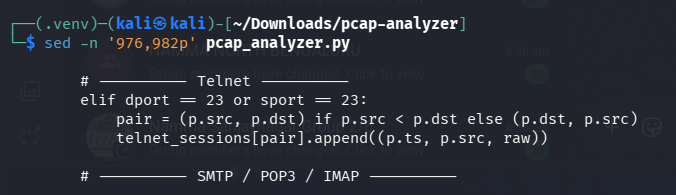

---

## Phase 8: Passive vulnerability identification

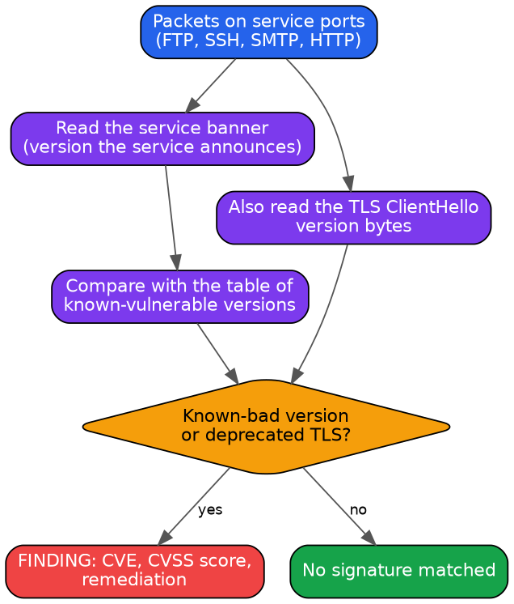

This module sends nothing. It reads the version banners that services announce
in the capture (FTP, SSH, HTTP, SMTP) and the TLS version in a ClientHello, then
compares them with a table of known-vulnerable releases. Each entry carries the
CVE, the published CVSS base score and a one-line remediation.

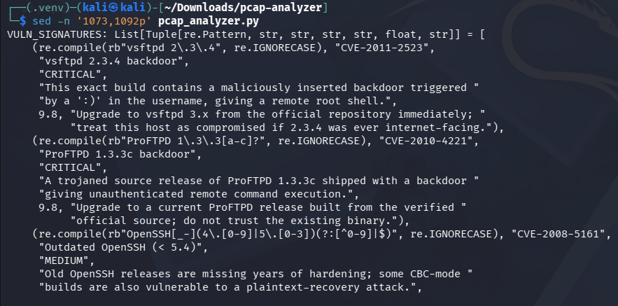

The TLS version sits at a fixed position in the ClientHello record, so two bytes
are enough to catch SSLv3, TLS 1.0 and TLS 1.1 without a TLS library.

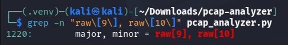

```bash
python3 pcap_analyzer.py -r samples/synthetic_demo.pcap --vuln
```

| Finding | CVE | CVSS |
|---|---|---|
| vsftpd 2.3.4 backdoor | CVE-2011-2523 | 9.8 |
| Apache 2.4.49 path traversal | CVE-2021-41773 | 9.8 |
| OpenSSL Heartbleed (from the Apache `Server:` header) | CVE-2014-0160 | 7.5 |
| Outdated OpenSSH | CVE-2008-5161 | 5.9 |
| TLS 1.0 offered | none | 4.3 |

That is 5 findings, 3 of them CRITICAL.

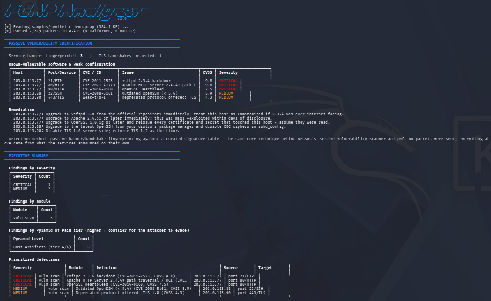

**A bug I found here:** the vsftpd signature was case-sensitive, but the real
banner reads `vsFTPd`, so it was missed silently. Every signature now uses
`re.IGNORECASE`.

The table holds about ten curated CVEs. It does not replace a full scanner, and
it only sees services that spoke during the recording.

---

## Phase 9: Automated testing

```bash
python3 -m unittest discover -s tests -v
```

All 30 tests pass. They check each module against the known contents of the
synthetic capture, including negative cases: an innocent host is not flagged as
a scanner, and `google.com` is not flagged as a tunnel.

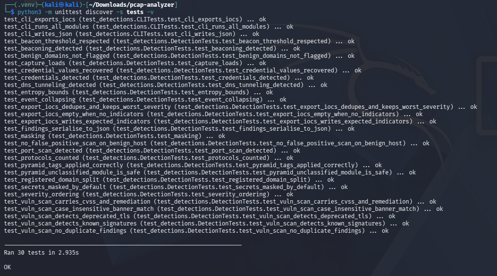

To check that the tests catch real regressions, I removed the case-insensitivity
fix from a copy of the file on purpose. The suite then failed (2 failures and 1
error, all in the vulnerability tests):

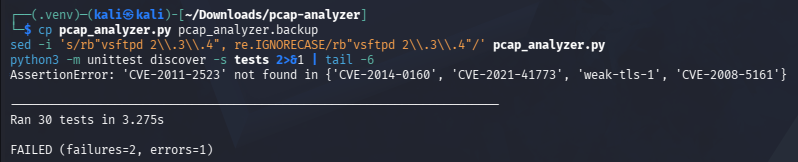

Restoring the file brought the suite back to green:

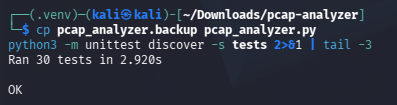

---

## Phase 10: Active scan with Nmap

The analyzer is passive, so I cross-checked it with an active scan. With the SSH
service started on the Kali host, `tools/run_nmap_scan.sh` ran
`nmap -sV --script vuln` against `127.0.0.1` (the same machine).

```bash
chmod +x tools/run_nmap_scan.sh
sudo systemctl start ssh
./tools/run_nmap_scan.sh 127.0.0.1
sudo systemctl stop ssh
```


Nmap 7.99 finished in 16.21 seconds. Port `22/tcp` was open, running **OpenSSH
10.3p1 Debian 4 (protocol 2.0)**, and the `vulners` script listed **11 CVEs**
matched to that version, with scores from 2.5 to 9.4.

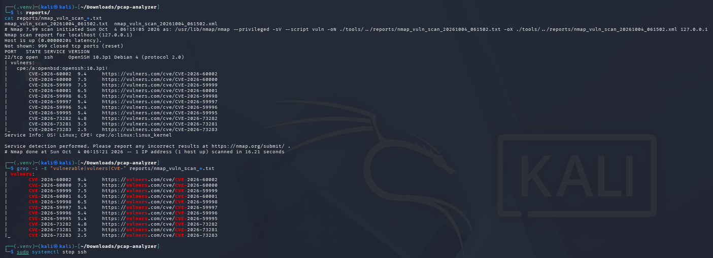

**Triage.** The highest-scored entry is CVE-2026-60002, a use-after-free in the
OpenSSH client (`ssh`) during key re-exchange. It affects versions before 10.4
and was fixed in 10.4p1 (release notes: https://www.openssh.org/releasenotes.html#10.4p1).
It occurs only on the client side, so it concerns the `ssh` binary on the host
rather than the `sshd` service that Nmap probed. Published scores differ between
sources (7.7 and 9.4 both appear), and the CISA entry in the CVE record lists
exploitation as "none" and automatable as "no". For a lab host that makes it low
urgency, and the remedy is upgrading to 10.4p1 or later through the package
manager. The other entries in the list are version matches of the same kind and
were not researched one by one.

**Why Nmap and the analyzer disagree.** The analyzer matches banners against a
small curated table with no entry for OpenSSH 10.x, so it reports nothing for
this host. The `vulners` script looks the detected version up in a large
database, so it reports more. A version match shows possible exposure only:
distributions can backport fixes without changing the version string, so it does
not prove the software is exploitable.

---

## Phase 11: Active scan with Nessus

I ran a Basic Network Scan with Nessus Essentials against the Kali host
(`192.168.10.250`, a machine I own). It took 9 minutes. Nessus reported 92
findings for the host, nearly all Info, plus one Medium: **SSL Certificate
Cannot Be Trusted** (plugin 51192, CVSS v3.0 6.5) on port 8834.

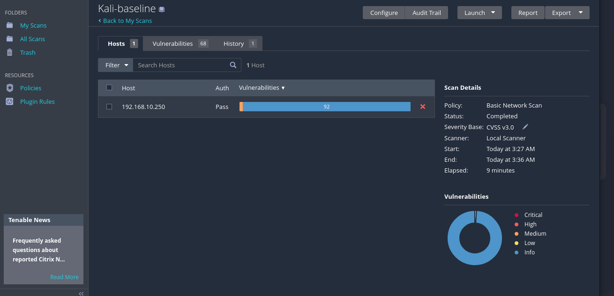

Port 8834 is Nessus's own web interface, and the certificate is the self-signed
one Nessus generates when it is installed. So the finding concerns the scanner's
own management page, not the operating system, and the fix is a certificate
rather than a software patch.

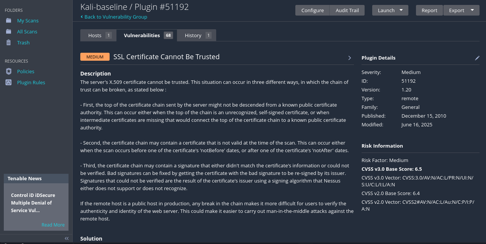

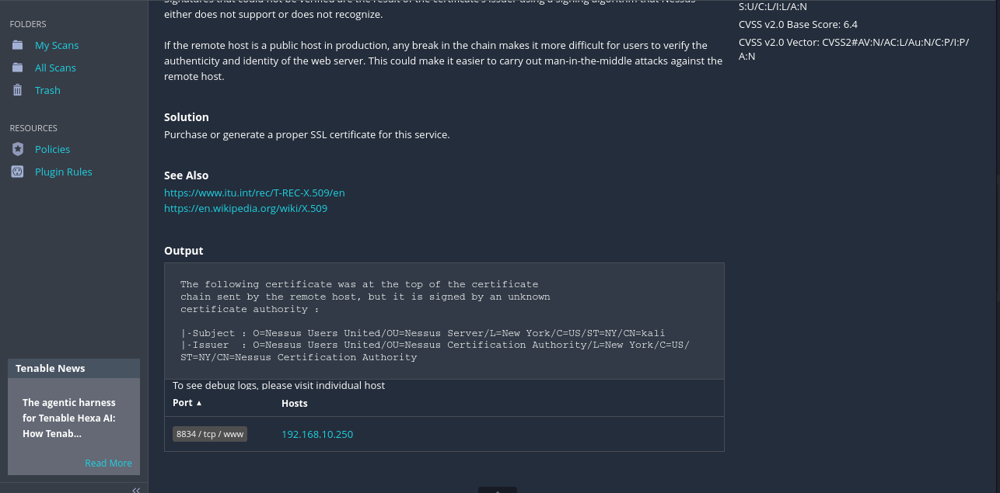

Nessus Essentials cannot export reports, so the evidence is these screenshots
and the written summary in `evidence/nessus/nessus_scan_summary.md`.

---

## Phase 12: Patch planning and remediation check

Scanning finds problems, but patch management also needs an order to work in and
a way to confirm that a fix worked. I added two features for those steps.

**Patch plan (`--patch-plan`).** It turns the vulnerability findings into a list
ordered by CVSS score. Each entry gets a priority band (P1 at 9.0 and above, P2
at 7.0 to 8.9, P3 at 4.0 to 6.9, P4 below 4.0), an example patch window and the
fix from the signature table. The windows are examples, to be replaced by a real
policy.

```bash
python3 pcap_analyzer.py -r samples/synthetic_demo.pcap --patch-plan
```

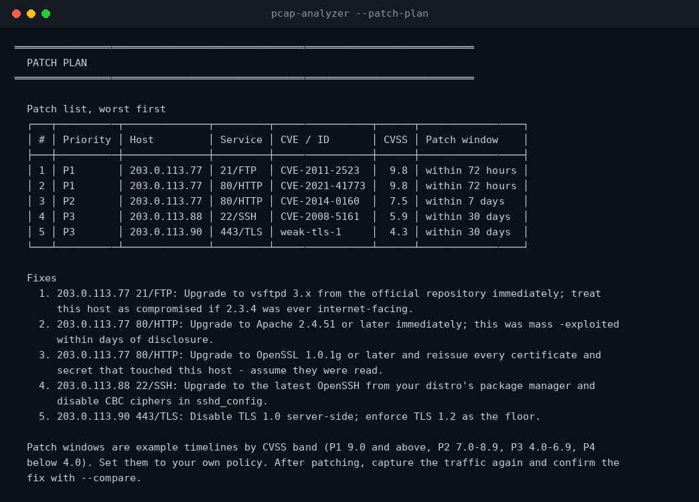

**Remediation check (`--compare`).** After patching, I capture the traffic again,
save both reports with `--vuln --json`, and compare them. To test this I added a
`--patched` option to the capture generator. It builds the same traffic with
vsftpd, OpenSSH, OpenSSL and the TLS version upgraded, and leaves Apache 2.4.49
unpatched on purpose so the check has something to catch.

```bash
python3 tools/generate_test_pcap.py -o samples/before.pcap
python3 tools/generate_test_pcap.py -o samples/after.pcap --patched
python3 pcap_analyzer.py -r samples/before.pcap --vuln --json reports/before.json
python3 pcap_analyzer.py -r samples/after.pcap --vuln --json reports/after.json
python3 pcap_analyzer.py --compare reports/before.json reports/after.json
```

The check reported 4 findings resolved, 1 still present (Apache 2.4.49,
CVE-2021-41773) and 0 new, so 80% of the earlier findings were gone. It exits
with 1 while anything remains, which makes it usable in a script.

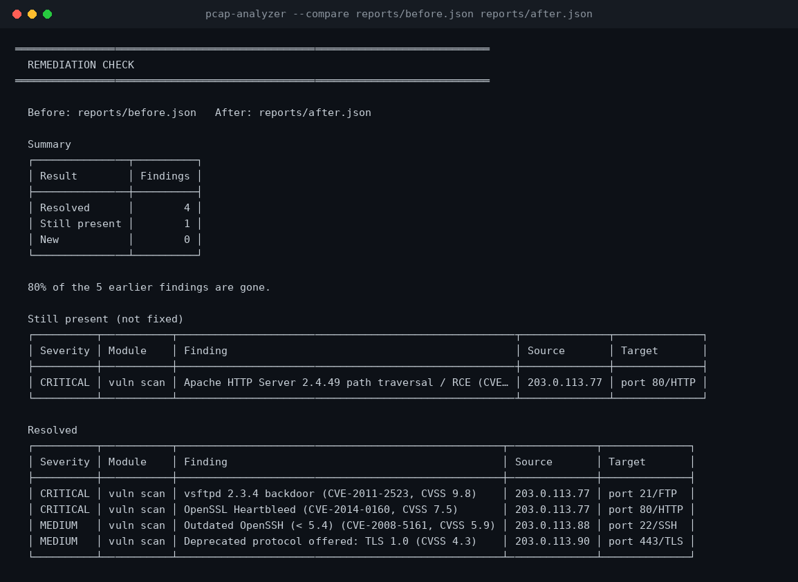

The `--patched` capture is synthetic. These features cover the planning and
verification steps, and applying the patches happens on the systems being
managed. Findings are matched by module, source, target and title, so the check
works best on the vulnerability findings, whose titles stay the same between
runs.

Ten new tests in `tests/test_patch_tools.py` cover the priority bands, the plan
ordering, the before and after comparison, the exit codes and the error
handling. The full suite now has 40 tests.

---

## Phase 13: Publishing

The project is published on GitHub as `SujalParmar/pcap-analyzer`, with the
code, tests, documentation and scan evidence in one repository.

---

## Bugs found while building

| Bug | Cause | Fix |
|---|---|---|
| Telnet credentials not recovered | Prompts and replies travel in opposite directions and were grouped separately | Group by sorted endpoint pair, order by timestamp |
| vsftpd banner not matched | The signature was case-sensitive and the banner is `vsFTPd` | `re.IGNORECASE` on every signature |
| Ragged table borders in a colored terminal | Column widths counted the color codes as visible characters | Measure the visible length with color codes stripped |

## Known limitations

See the Limitations section of the main README.
