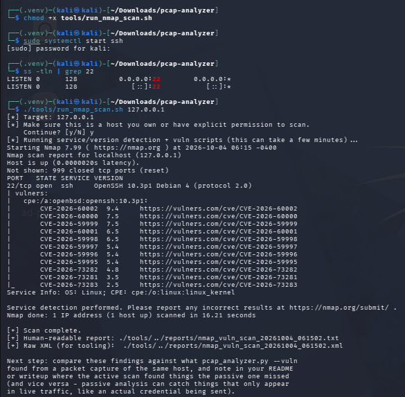

# Nmap evidence

Screenshots of the active scan of the Kali lab host (`tools/run_nmap_scan.sh`,
which runs `nmap -sV --script vuln`).

Starting SSH, confirming port 22 is listening, and running the scan against
`127.0.0.1`:

The saved report, the `vulners` CVE list for OpenSSH 10.3p1 (11 entries), and a
search for CVE lines in the report:

The triage of the highest-scored entry is in
[docs/PROJECT_WALKTHROUGH.md](../../docs/PROJECT_WALKTHROUGH.md#phase-10-active-scan-with-nmap).
